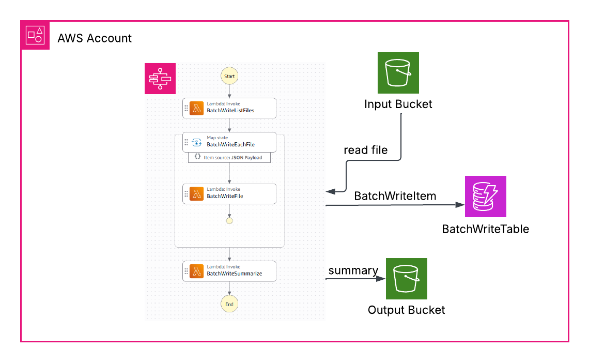
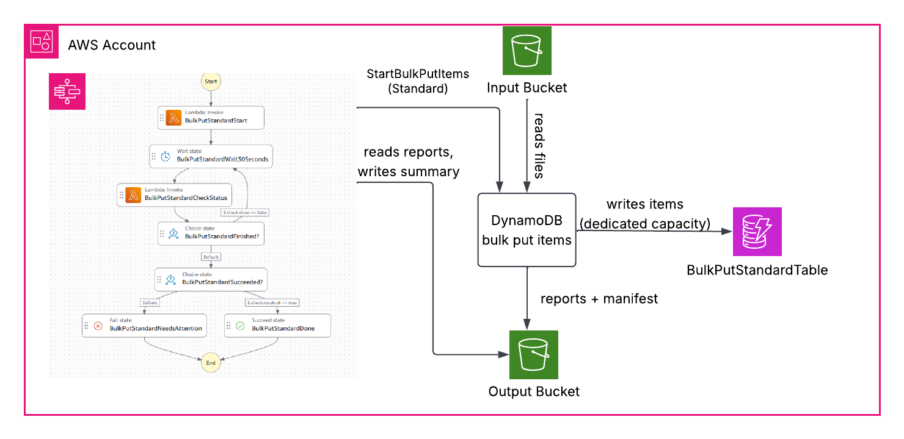
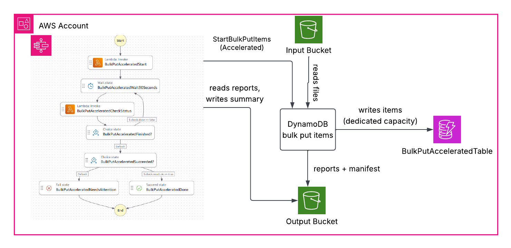
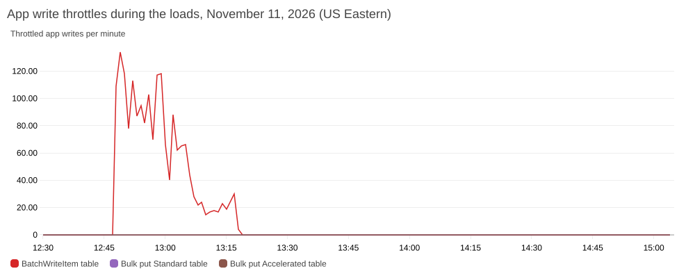

# Amazon DynamoDB Bulk Put Items - A Developer's Take

Loading a large batch of data into a DynamoDB table that is already serving traffic has been a challenge. Until now, it meant a `BatchWriteItem` loader or a Glue or EMR job, and handling capacity and throttling yourself. Import from S3 only creates new tables ([AWS Database Blog](https://aws.amazon.com/blogs/database/amazon-dynamodb-can-now-import-amazon-s3-data-into-a-new-table/)).

On November 5, 2026, AWS announced [bulk put items for Amazon DynamoDB](https://aws.amazon.com/about-aws/whats-new/2026/11/amazon-dynamodb-now-supports-bulk-put-items/). You point it at files in S3, and DynamoDB writes the items into an existing table and reports what it could not write. This article explains how it works, and what we found when we tested it against `BatchWriteItem` with 10 million items, with and without app traffic.

The complete source, a Python app and a CDK stack, is in the [amazon_dynamodb_bulk_put_items](https://github.com/ssathasivan/amazon_dynamodb_bulk_put_items) repository.

## How it works

Bulk put items is an asynchronous operation, and DynamoDB writes the records in the background. The writes don't use the table's capacity, so they don't compete with your application.

The input is line-delimited DynamoDB JSON or [Amazon Ion](https://amazon-ion.github.io/ion-docs/), either uncompressed or compressed with gzip or zstd. Each line is one record (a JSON object or an Ion struct): the item to write and, optionally, a condition. All files under one S3 prefix must use the same format and compression. The files can also be in a different account from the table.

There are two performance tiers:

- Standard is the default, for loads without a deadline, and is in all commercial Regions and AWS GovCloud (US).
- Accelerated is for loads that must finish fast, is in [selected Regions](https://docs.aws.amazon.com/amazondynamodb/latest/developerguide/BulkPutItems.Tiers.html#BulkPutItems.Tiers.Accelerated), and costs twice as much.

## Conditions

A record's condition uses `PutItem` syntax and is checked against the item already in the table. In this example, the table already holds all three products at `Version 1` (`payload` is shortened):

```json
{"Item": {"sku": {"S": "sku-000000005"}, "category": {"S": "cat-05"}, "Version": {"N": "2"}, "title": {"S": "Product 5"}, "payload": {"S": "xxx..."}}}
{"Item": {"sku": {"S": "sku-000020005"}, "category": {"S": "cat-05"}, "Version": {"N": "2"}, "title": {"S": "Product 20005"}, "payload": {"S": "xxx..."}}, "ConditionExpression": "attribute_not_exists(sku)"}
{"Item": {"sku": {"S": "sku-000040005"}, "category": {"S": "cat-05"}, "Version": {"N": "2"}, "title": {"S": "Product 40005"}, "payload": {"S": "xxx..."}}, "ConditionExpression": "#v < :v", "ExpressionAttributeNames": {"#v": "Version"}, "ExpressionAttributeValues": {":v": {"N": "2"}}}
```

- The first line has no condition, so Product 5 is overwritten at `Version 2`.
- The second is written only if the item doesn't exist, so Product 20005 is skipped.
- The third is a version guard: it is written only if its `Version` is higher than the table's, so old data can't replace newer data. Here 2 is higher than 1, so it is written.

`#v < :v` on its own also skips new keys, because a missing `Version` can't be compared. To write both new keys and newer versions, AWS's example uses `attribute_not_exists(#v) OR #v < :v` ([Considerations](https://docs.aws.amazon.com/amazondynamodb/latest/developerguide/BulkPutItems.Considerations.html)).

In a separate run of 100,010 records with these conditions, both tiers wrote 60,000, skipped exactly the 40,000 planned, and reported the 10 records with no key as errors.

## Starting a load

To start the load, run:

```bash
aws dynamodb start-bulk-put-items \
    --table-name BulkPutStandardTable \
    --input-s3-configuration '{"S3Bucket":"bulk-put-input-111122223333-us-east-1","S3KeyPrefix":"batches/conflict-test/data/","InputFormat":"DYNAMODB_JSON","InputCompressionType":"GZIP"}' \
    --output-s3-configuration '{"S3Bucket":"bulk-put-output-111122223333-us-east-1","S3KeyPrefix":"bulk-put-output/","OutputType":["ERROR","CONDITION_CHECK_FAILURE"]}' \
    --performance-tier STANDARD \
    --client-token catalog-load-2026-11-16
```

Use `ACCELERATED` for the Accelerated tier.

The caller can pass an optional `--client-token`. If it doesn't, the AWS SDK or CLI generates one.

If you retry with the same token and parameters within 8 hours, DynamoDB returns the original load instead of starting a second one. Use a new token for each new load. A reused token with the same parameters returns the old load without an error.

## Reports and statuses

When a load ends, DynamoDB can write three kinds of files to the output bucket:

- A manifest, which lists each input file and whether it was read in full.
- An `ERROR` report, which lists records rejected for bad data, such as a missing key.
- A `CONDITION_CHECK_FAILURE` report, which lists records skipped because their condition was false.

You get each report only if you list it in `OutputType` and at least one record belongs in it.

Each load ends with one status for the whole load, which `DescribeBulkOperation` returns: `COMPLETED`, `COMPLETED_WITH_ERRORS` (some records were rejected), `CANCELLED`, or `FAILED`. Records skipped by a condition don't count as errors, so a load can end as `COMPLETED` even when it skipped records.

## Sample project

The CDK project loads the same data in three ways. It deploys:

- an input bucket for the product records, in gzip files
- an output bucket for the bulk put reports and manifest, plus a summary file for each run
- three on-demand tables: `BatchWriteTable`, `BulkPutStandardTable` and `BulkPutAcceleratedTable`
- three Step Functions workflows, one per table, started with the same input
- an `AppTraffic` workflow and Lambda that send app traffic to the tables during one of the loads
- a CloudWatch dashboard, `BulkPutComparison`, with items loaded, table capacity used and throttles for all three tables, plus the app's write latency and throttles

### BatchWrite

This workflow writes the items using `BatchWriteItem`, 20 files at a time.



### BulkPutStandard

This workflow writes the items using bulk put items on the Standard tier.



### BulkPutAccelerated

This workflow writes the items using bulk put items on the Accelerated tier.



### Step Functions overview

In each workflow, a Lambda function starts the writes. In BatchWrite, it calls `BatchWriteItem`. In BulkPutStandard and BulkPutAccelerated, it calls `StartBulkPutItems`, because at the time of writing Step Functions has no SDK integration for it. In the bulk put workflows, Step Functions then checks `DescribeBulkOperation` every 30 seconds until the load finishes.

The input is split into equal files with shuffled keys, as AWS recommends ([Best practices](https://docs.aws.amazon.com/amazondynamodb/latest/developerguide/BulkPutItems.BestPractices.html)). All three workflows start at the same time on the same files, without conditions because `BatchWriteItem` can't use them, so the method is the only difference.

### Permissions

Bulk put items runs with the caller's permissions, so the start Lambda's role has:

- `dynamodb:StartBulkOperation` and `dynamodb:BulkPutItems`, with `BulkPutItems` allowed only on the two bulk put tables
- `dynamodb:DescribeBulkOperation`, `dynamodb:CancelBulkOperation` and `dynamodb:ListBulkOperations`, to monitor and cancel an operation
- `s3:GetObject` and `s3:ListBucket` on the input bucket
- `s3:PutObject` and `s3:AbortMultipartUpload` on the output bucket

The buckets use S3-managed encryption, so the role needs no `kms:` permissions. With a customer managed KMS key, add `kms:Decrypt` and `kms:GenerateDataKey`. Without `kms:Decrypt`, the start fails with `AccessDeniedException` ([Considerations](https://docs.aws.amazon.com/amazondynamodb/latest/developerguide/BulkPutItems.Considerations.html)).

### Deploying

You need AWS credentials in your shell, Python 3.10 or later, Node.js and the CDK CLI (`npm i -g aws-cdk@latest`). Use a Region that has the Accelerated tier. We ran everything in us-east-1.

```bash
git clone https://github.com/ssathasivan/amazon_dynamodb_bulk_put_items.git
cd amazon_dynamodb_bulk_put_items
python -m venv .venv
source .venv/bin/activate
pip install -r infra/requirements.txt -r app/requirements.txt

cd infra
cdk bootstrap                        # once per account and Region
cdk deploy
```

## Test: 10 million items

The test loads 10 million products of about 1 KB each, about 10 GB in 100 gzip files, with no conditions. AWS recommends Standard for loads under 1 GB ([AWS Database Blog](https://aws.amazon.com/blogs/database/introducing-bulk-put-items-for-amazon-dynamodb-load-data-from-amazon-s3-into-existing-tables-at-scale/)), so we used 10 GB to give Accelerated a fair chance. We ran it three times: into new tables, then twice into the same tables. Then we redeployed for new tables and ran a fourth load with app traffic, to see whether a load affects an application on the same table.

The app traffic is a Lambda that sends 200 `GetItem` and 50 `PutItem` requests per second to each table, with one attempt per request, so every throttle is counted. The README has the details.

This creates the files and uploads them to `s3://<InputBucketName>/batches/catalog-10m/data/`:

```bash
python -m bulkput generate --count 10000000 --batch catalog-10m --shards 100
```

For the runs without app traffic, run this three times:

```bash
python -m bulkput start --batch catalog-10m
python -m bulkput compare
```

For the run with app traffic, start the traffic on new tables, wait 10 minutes for a baseline, then start the loads. `traffic-report` compares the baseline with each load:

```bash
python -m bulkput traffic-start --minutes 180 --reads 200 --writes 50
python -m bulkput start --batch catalog-10m
python -m bulkput traffic-report
python -m bulkput traffic-stop
```

### Results without app traffic

Run 1 loaded into new tables. Runs 2 and 3 loaded into the same tables again, so every record replaced an existing item. Every load wrote all 10 million items.

| Method | Run 1: new tables | Run 2: same tables | Run 3: same tables | Table capacity used per run | Write throttles (run 1 / 2 / 3) |
|---|---:|---:|---:|---:|---:|
| Bulk put, Standard | 2 h 8 min 16 s | 30 min 7 s | 23 min 2 s | 0 | 0 / 0 / 0 |
| Bulk put, Accelerated | 1 h 43 min 40 s | 30 min 32 s | 22 min 12 s | 0 | 0 / 0 / 0 |
| BatchWriteItem | 28 min 23 s | 10 min 43 s | 5 min 31 s | about 10,000,000 | 1,001,970 / 130,900 / 41,412 |

`BatchWriteItem` was faster in every run, by 2.8 to 4.5 times, and was throttled in every run.

Accelerated was about 1.2 times faster than Standard in run 1, into new tables. In runs 2 and 3, the two tiers took about the same time.

Every run was faster than the one before. Standard went from over 2 hours to 23 minutes and was still getting faster. AWS says Accelerated times typically settle after three to five runs ([AWS Database Blog](https://aws.amazon.com/blogs/database/introducing-bulk-put-items-for-amazon-dynamodb-load-data-from-amazon-s3-into-existing-tables-at-scale/)). Our fastest Accelerated run took 22 min 12 s, against AWS's estimate of under 10 minutes for 10 million 1 KB items on a well-scaled table ([Performance tiers](https://docs.aws.amazon.com/amazondynamodb/latest/developerguide/BulkPutItems.Tiers.html)).

### Results with app traffic

In this run, the app sent traffic to all three tables throughout. We started it 10 minutes before the loads, and the app had no throttles in that time. During the loads, only the app's writes were throttled, never its reads.

| Method | Load time | Table capacity used by the load | Write throttles on the load | App writes throttled |
|---|---:|---:|---:|---:|
| `BatchWriteItem` | 30 min | about 10,000,000 | 1,162,742 | about 1,900 (about 2%) |
| Bulk put, Standard | 2 h 7 min | 0 | 0 | 0 |
| Bulk put, Accelerated | 1 h 58 min | 0 | 0 | 0 |



During the `BatchWriteItem` load, about 2% of the app's writes were throttled. During the bulk put loads, none were, which matches AWS's claim that bulk writes don't compete with your application. This was the worst case for `BatchWriteItem`, because our loader wrote as fast as it could, and new on-demand tables can sustain up to 4,000 writes per second ([On-demand capacity mode](https://docs.aws.amazon.com/amazondynamodb/latest/developerguide/on-demand-capacity-mode.html)). A loader that left spare capacity would throttle the app less, but take longer.

Latency didn't change. DynamoDB's p99 latency for the app's requests stayed between 2.6 and 5.2 ms throughout, from the `SuccessfulRequestLatency` metric ([Metrics and dimensions](https://docs.aws.amazon.com/amazondynamodb/latest/developerguide/metrics-dimensions.html)).

Every load, including both bulk put loads, had a few HTTP 500 errors: 13 to 53 per load, at most 0.003% of requests. There were none before the loads. A client with retries would normally handle them.

Standard took about the same time as in run 1 without traffic. Accelerated took about 15 minutes longer.

We ran the test four times, so treat these results as directional.

## Clean up

```bash
cd ../infra
cdk destroy
```

The buckets use `auto_delete_objects` and the tables use `RemovalPolicy.DESTROY`, so one command removes everything. Don't copy those settings into a production stack.

## Approximate cost

Bulk put items is cheaper than `BatchWriteItem` on an on-demand table. The 10 million row is what our test cost, for 1 KB items in us-east-1. The 100 million row is an estimate at the same rates. Both convert metered bytes to GiB.

| Items | Bulk put, Standard | Bulk put, Accelerated | `BatchWriteItem`, on-demand |
|---|---:|---:|---:|
| 10 million (our test) | $0.95 | $1.91 | $6.25 |
| 100 million | $9.54 | $19.07 | $62.50 |

Bulk put charges by item size, and items smaller than 1 KB are charged as 1 KB. Each index on the table is charged separately.

If your table uses provisioned capacity, these numbers don't apply. `BatchWriteItem` writes into capacity you already pay for. Prices for other Regions are on the [DynamoDB pricing page](https://aws.amazon.com/dynamodb/pricing/).

## Gotchas

- Use a different client token for each load. DynamoDB remembers a token for 8 hours after the first call, even if that load has already finished. If a second load with different parameters uses the same token in that time, it fails with `IdempotentParameterMismatchException`.
- Look for reports outside the manifest's folder. The manifest is in `<operation-id>/`, but the reports are in `<operation-id>-0/`, `<operation-id>-1/` and so on. List everything that starts with `<operation-id>`, without the trailing slash, to find them all.
- If your records have conditions, ask for the `CONDITION_CHECK_FAILURE` report. Without it, you can't tell which records were skipped, or how many.
- Add a version guard to every record. If DynamoDB retries part of a load, it can write a record a second time. Without a condition, that second write overwrites any change your app made in between. A version guard skips the second write if the table already has a newer version. Use `attribute_not_exists(#v) OR #v < :v`, so new items are still written, and make your app increase `Version` on every change.
- Cancelling doesn't undo anything. Items written before you cancel stay in the table.
- Bulk put items does not support global tables.
- Items that fail a condition check are billed. Items rejected by validation before a table write is attempted are not billed as table writes. For the full billing details, see [Billing for reports and failed items](https://docs.aws.amazon.com/amazondynamodb/latest/developerguide/BulkPutItems.Output.html#BulkPutItems.Output.Billing).
- The caller must be in the table's account. Only the S3 buckets can be in another account.

For size limits, quotas and unsupported features, see [Considerations](https://docs.aws.amazon.com/amazondynamodb/latest/developerguide/BulkPutItems.Considerations.html).

## Pros and cons

| Pros | Cons |
|---|---|
| Doesn't use your table's capacity, so your app isn't throttled during a load | 2.8 to 4.5 times slower than `BatchWriteItem` |
| Each record can have its own condition | Accelerated costs twice as much, and was faster only on loads into new tables |
| The reports list every record that failed, with its file and position | The first load into a new table is slow: about 2 hours on Standard, against 23 to 30 minutes on later loads |
| About 6.5 times cheaper than `BatchWriteItem` on an on-demand table | No count of records skipped by a condition |
| One API call starts the load, with no loader code to write or run | Doesn't work with global tables |

## Conclusion

Use bulk put items when the table is serving live traffic, or when cost matters more than speed. In our test, the app wasn't throttled during bulk put loads, against 2% of its writes during the `BatchWriteItem` load, and Standard cost about 6.5 times less.

Use `BatchWriteItem` when the load must finish fast and the table has no other traffic. It was 2.8 to 4.5 times faster in every run.

Start with Standard. Accelerated was faster only on loads into new tables, at twice the price.

## References

- [Amazon DynamoDB now supports bulk put items](https://aws.amazon.com/about-aws/whats-new/2026/11/amazon-dynamodb-now-supports-bulk-put-items/)
- [Introducing bulk put items for Amazon DynamoDB (AWS Database Blog)](https://aws.amazon.com/blogs/database/introducing-bulk-put-items-for-amazon-dynamodb-load-data-from-amazon-s3-into-existing-tables-at-scale/)
- [Working with bulk put items](https://docs.aws.amazon.com/amazondynamodb/latest/developerguide/BulkPutItems.HowItWorks.html)
- [Performance tiers](https://docs.aws.amazon.com/amazondynamodb/latest/developerguide/BulkPutItems.Tiers.html)
- [Amazon S3 input formats for bulk put items](https://docs.aws.amazon.com/amazondynamodb/latest/developerguide/BulkPutItems.Format.html)
- [Running a bulk put items operation](https://docs.aws.amazon.com/amazondynamodb/latest/developerguide/BulkPutItems.Requesting.html)
- [Bulk put items output and reconciliation](https://docs.aws.amazon.com/amazondynamodb/latest/developerguide/BulkPutItems.Output.html)
- [Bulk put items best practices](https://docs.aws.amazon.com/amazondynamodb/latest/developerguide/BulkPutItems.BestPractices.html)
- [Bulk put items considerations, quotas, and permissions](https://docs.aws.amazon.com/amazondynamodb/latest/developerguide/BulkPutItems.Considerations.html)
- [DynamoDB on-demand capacity mode](https://docs.aws.amazon.com/amazondynamodb/latest/developerguide/on-demand-capacity-mode.html)
- [DynamoDB metrics and dimensions](https://docs.aws.amazon.com/amazondynamodb/latest/developerguide/metrics-dimensions.html)
- [Amazon DynamoDB can now import Amazon S3 data into a new table](https://aws.amazon.com/blogs/database/amazon-dynamodb-can-now-import-amazon-s3-data-into-a-new-table/)
- [Amazon DynamoDB pricing](https://aws.amazon.com/dynamodb/pricing/)
