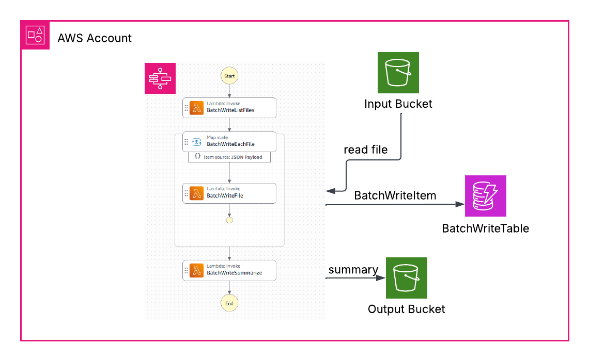
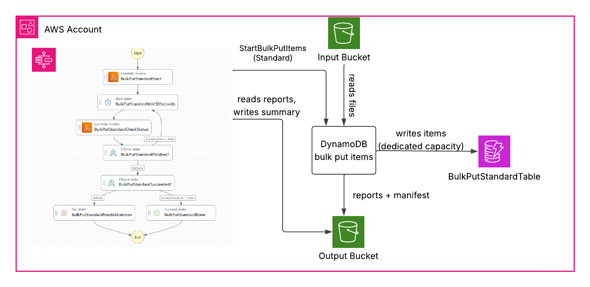
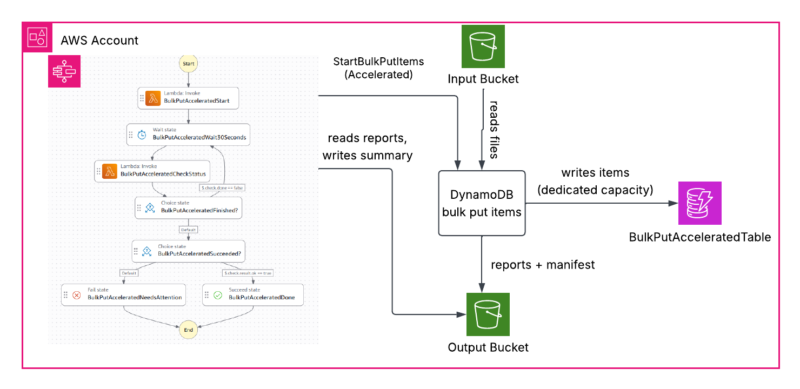

# Amazon DynamoDB Bulk Put Items - A Developer's Take

Loading a large batch of data into a DynamoDB table that is already serving traffic has always needed care. Until now, it meant a `BatchWriteItem` loader or a Glue or EMR job, and handling capacity and throttling yourself. Import from S3 only creates new tables ([AWS Database Blog](https://aws.amazon.com/blogs/database/amazon-dynamodb-can-now-import-amazon-s3-data-into-a-new-table/)).

On November 5, 2026, AWS announced [bulk put items for Amazon DynamoDB](https://aws.amazon.com/about-aws/whats-new/2026/11/amazon-dynamodb-now-supports-bulk-put-items/). You point it at files in S3, and DynamoDB writes the items into an existing table and reports what it could not write. This article explains how it works, and what we found when we tested it against `BatchWriteItem` with 1 million and 10 million items, with and without app traffic.

The complete source, a Python app and a CDK stack, is in the [amazon_dynamodb_bulk_put_items](https://github.com/ssathasivan/amazon_dynamodb_bulk_put_items) repository.

## How it works

Bulk put items is an asynchronous operation. `StartBulkPutItems` returns an operation ARN straight away, and DynamoDB writes the records in the background. The writes don't use the table's capacity, so they don't compete with your application. Our third test checks this.

The input is line-delimited DynamoDB JSON or [Amazon Ion](https://amazon-ion.github.io/ion-docs/), either uncompressed or compressed with gzip or zstd. Each line is one record: the item to write and, optionally, a condition. All files under one S3 prefix must use the same format and compression. The files can also be in a different account from the table.

There are two performance tiers. Standard is the default, for loads without a deadline, and is in all commercial Regions and AWS GovCloud (US). Accelerated is for loads that must finish fast, is in a subset of Regions, and costs twice as much.

## Conditions

A record's condition uses `PutItem` syntax and is checked against the item already in the table. These three records come from our second test, where the table already holds all three products at `Version 1` (`payload` is shortened):

```json
{"Item": {"sku": {"S": "sku-000000005"}, "category": {"S": "cat-05"}, "Version": {"N": "2"}, "title": {"S": "Product 5"}, "payload": {"S": "xxx..."}}}
{"Item": {"sku": {"S": "sku-000020005"}, "category": {"S": "cat-05"}, "Version": {"N": "2"}, "title": {"S": "Product 20005"}, "payload": {"S": "xxx..."}}, "ConditionExpression": "attribute_not_exists(sku)"}
{"Item": {"sku": {"S": "sku-000040005"}, "category": {"S": "cat-05"}, "Version": {"N": "2"}, "title": {"S": "Product 40005"}, "payload": {"S": "xxx..."}}, "ConditionExpression": "#v < :v", "ExpressionAttributeNames": {"#v": "Version"}, "ExpressionAttributeValues": {":v": {"N": "2"}}}
```

The first line has no condition, so Product 5 is overwritten at `Version 2`. The second is written only if the item doesn't exist, so Product 20005 is skipped. The third is a version guard: it is written only if its `Version` is higher than the table's, so old data can't replace newer data. Here 2 is higher than 1, so it is written.

`#v < :v` on its own also skips new keys, because a missing `Version` can't be compared. To write both new keys and newer versions, AWS uses `attribute_not_exists(#v) OR #v < :v` ([Considerations](https://docs.aws.amazon.com/amazondynamodb/latest/developerguide/BulkPutItems.Considerations.html)).

## Starting a load

One command starts a load:

```bash
aws dynamodb start-bulk-put-items \
    --table-name BulkPutStandardTable \
    --input-s3-configuration '{"S3Bucket":"bulk-put-input-111122223333-us-east-1","S3KeyPrefix":"batches/conflict-test/data/","InputFormat":"DYNAMODB_JSON","InputCompressionType":"GZIP"}' \
    --output-s3-configuration '{"S3Bucket":"bulk-put-output-111122223333-us-east-1","S3KeyPrefix":"bulk-put-output/","OutputType":["ERROR","CONDITION_CHECK_FAILURE"]}' \
    --performance-tier STANDARD
```

Use `ACCELERATED` for the Accelerated tier. If you pass a client token, a retried start returns the existing operation instead of starting a second one. DynamoDB keeps the token for 8 hours.

## Reports and statuses

DynamoDB writes a manifest, which says whether each input file was read in full, and up to two reports: `ERROR`, for records with bad data such as a missing key, and `CONDITION_CHECK_FAILURE`, for records skipped because their condition was false. You only get the second one if you ask for it in `OutputType`.

An operation ends as `COMPLETED`, `COMPLETED_WITH_ERRORS` when some records failed, `CANCELLED` or `FAILED`. `COMPLETED` can still include records skipped by a condition.

## Sample project

The CDK project loads the same data in three ways. It deploys:

- an input bucket for the product records, in gzip files
- an output bucket for the bulk put reports and manifest, plus a summary file for each run
- three on-demand tables: `BatchWriteTable`, `BulkPutStandardTable` and `BulkPutAcceleratedTable`
- three Step Functions workflows, one per table, started with the same input
- an `AppTraffic` workflow and Lambda that send app traffic to the tables during the third test
- a CloudWatch dashboard, `BulkPutComparison`, with items loaded, table capacity used and throttles for all three tables, plus the app's write latency and throttles

### BatchWrite

This workflow writes the items using `BatchWriteItem`, 20 files at a time.



### BulkPutStandard

This workflow writes the items using bulk put items on the Standard tier.



### BulkPutAccelerated

This workflow writes the items using bulk put items on the Accelerated tier.



### Why a Lambda starts the load

Step Functions can't call `StartBulkPutItems` directly yet. On November 11, 2026, `aws stepfunctions validate-state-machine-definition` in us-east-1 rejected `arn:aws:states:::aws-sdk:dynamodb:startBulkPutItems` with "The resource provided … is not recognized", so a Lambda makes the call. AWS adds SDK integrations over time, so check again before you copy this design.

The waiting happens in Step Functions, which checks `DescribeBulkOperation` every 30 seconds, instead of one Lambda waiting for many minutes.

The input is split into equal files with shuffled keys, as AWS recommends ([Best practices](https://docs.aws.amazon.com/amazondynamodb/latest/developerguide/BulkPutItems.BestPractices.html)). All three workflows start at the same time on the same files, without conditions in the speed tests because `BatchWriteItem` can't use them, so the method is the only difference.

### Permissions

Bulk put items runs with the caller's permissions, so the start Lambda's role has:

- `dynamodb:StartBulkOperation` and `dynamodb:BulkPutItems`, with `BulkPutItems` allowed only on the two bulk put tables
- `dynamodb:DescribeBulkOperation`, `dynamodb:CancelBulkOperation` and `dynamodb:ListBulkOperations`, to monitor and cancel an operation
- `s3:GetObject` and `s3:ListBucket` on the input bucket
- `s3:PutObject` and `s3:AbortMultipartUpload` on the output bucket

The buckets use S3-managed encryption, so the role needs no `kms:` permissions. With a customer managed KMS key, add `kms:Decrypt` and `kms:GenerateDataKey`. Without `kms:Decrypt`, the start fails with `AccessDeniedException` ([Considerations](https://docs.aws.amazon.com/amazondynamodb/latest/developerguide/BulkPutItems.Considerations.html)).

### Deploying

You need AWS credentials in your shell, Python 3.10 or later, Node.js and the CDK CLI (`npm i -g aws-cdk@latest`). Use a Region that has the Accelerated tier. We ran everything in us-east-1.

```bash
git clone https://github.com/ssathasivan/amazon_dynamodb_bulk_put_items.git
cd amazon_dynamodb_bulk_put_items
python -m venv .venv
source .venv/bin/activate            # Windows: .venv\Scripts\Activate.ps1
pip install -r infra/requirements.txt -r app/requirements.txt

cd infra
cdk bootstrap                        # once per account and Region
cdk deploy
```

The stack bundles a newer boto3, because the Lambda runtime's own boto3 may not have `start_bulk_put_items` yet.

## Test 1: 1 million items

The first test loads 1 million products of about 1 KB, in 20 gzip files, so about 1 GB, with no conditions. We ran it twice: into the empty tables, then again into the same tables, so every record replaces an existing item.

This creates the files and uploads them to `s3://<InputBucketName>/batches/catalog-1m/data/`:

```bash
cd ../app
python -m bulkput generate --count 1000000 --batch catalog-1m --shards 20
```

This starts all three workflows with the same input. Run it a second time for the second run:

```bash
python -m bulkput start --batch catalog-1m
```

This prints each workflow's latest run. CloudWatch metrics can lag, so run it again if the capacity looks low:

```bash
python -m bulkput compare
```

### Results

**Run 1: new tables**

| Method | Load time | Items/s | Table capacity used | Write throttles |
|---|---:|---:|---:|---:|
| Bulk put, Standard | 23 min 5 s | 722 | 0 | 0 |
| Bulk put, Accelerated | 22 min 55 s | 727 | 0 | 0 |
| BatchWriteItem | 4 min 14 s | 3,937 | 1,000,000 | 387,018 |

**Run 2: same tables**

| Method | Load time | Items/s | Table capacity used | Write throttles |
|---|---:|---:|---:|---:|
| Bulk put, Standard | 8 min 46 s | 1,901 | 0 | 0 |
| Bulk put, Accelerated | 12 min 17 s | 1,357 | 0 | 0 |
| BatchWriteItem | 1 min 12 s | 13,889 | 1,000,000 | 17,833 |

Every load wrote all 1 million items. `BatchWriteItem` was 5 times faster in the first run and 7 to 10 times faster in the second, but it used 1 million capacity units and was throttled in both runs. In the table's CloudWatch metrics, both bulk put tables show 0 capacity used and 0 throttles, because bulk writes don't use the table's capacity ([Considerations](https://docs.aws.amazon.com/amazondynamodb/latest/developerguide/BulkPutItems.Considerations.html)).

Accelerated was no faster than Standard, and slower in the second run. AWS recommends Standard for loads under 1 GB ([AWS Database Blog](https://aws.amazon.com/blogs/database/introducing-bulk-put-items-for-amazon-dynamodb-load-data-from-amazon-s3-into-existing-tables-at-scale/)), so we tried 10 GB in the third test.

Every method was faster the second time. AWS says the first bulk put operations on a table can outpace table scaling ([Performance tiers](https://docs.aws.amazon.com/amazondynamodb/latest/developerguide/BulkPutItems.Tiers.html)). `BatchWriteItem` most likely got faster, and was throttled far less, because the on-demand table scaled up. On-demand tables handle up to double their previous peak straight away, and can throttle above that ([On-demand capacity mode](https://docs.aws.amazon.com/amazondynamodb/latest/developerguide/on-demand-capacity-mode.html)). In the third test, the warm throughput of `BatchWriteTable` grew from 4,000 to 15,668 writes per second after one load.

## Test 2: conditions and the report

The second test runs only the two bulk put workflows, on the tables from the first test, which hold the 1 million products at `Version` 1. The input is 100,010 records in 4 gzip files:

| Records | Condition | Expected |
|---|---|---|
| 20,000 existing keys, `Version` 2 | none | written |
| 20,000 existing keys | `attribute_not_exists(sku)` | skipped |
| 20,000 new keys | `attribute_not_exists(sku)` | written |
| 20,000 existing keys, `Version` 2 | `#v < :v`, with `:v` = 2 | written |
| 20,000 existing keys, `Version` 1 | `#v < :v`, with `:v` = 1 | skipped |
| 10 records with no `sku` | none | in the error report |

So we expect 60,000 written, 40,000 condition failures and 10 errors, with every touched key at the expected `Version`.

The README has the commands that reset the tables and upload the 100,010 records. This starts only the two bulk put workflows:

```bash
python -m bulkput start --batch conflict-test --bulk-only
```

This compares the report counts with the plan and checks the `Version` of all 100,000 touched keys:

```bash
python -m bulkput conflict-check
```

### Results

Both loads ended with the status `COMPLETED_WITH_ERRORS`, and both matched the plan.

| | Standard | Accelerated |
|---|---:|---:|
| Load time | 3 min 25 s | 2 min 39 s |
| Records read | 100,010 | 100,010 |
| Written | 60,000 | 60,000 |
| Condition failures | 40,000 | 40,000 |
| Errors | 10 | 10 |
| Files fully processed | 4 of 4 | 4 of 4 |
| Keys with the expected `Version` | 100,000 of 100,000 | 100,000 of 100,000 |

`DescribeBulkOperation` gave us `ProcessedItemCount` of 100,010 and `FailedItemCount` of 10. It has no count for condition failures, so the 40,000 came from the report files.

Each report record has the input file, the position (`itemIndex`) and the reason, for example "Missing the key sku in the item", so you can fix the bad records and load only those again. Condition failures also carry the item you sent (`newImage`) and the item in the table (`oldImage`). A report file is only written when it has records, so the first test produced only the manifest.

## Test 3: 10 million items

The third test repeats the first at 10 times the size, 10 million products in 100 gzip files, about 10 GB, to see whether Accelerated helps above 1 GB. We ran it three times: into new tables, then twice into the same tables. Then we redeployed for new tables and ran a fourth load with app traffic, to see whether a load affects an application on the same table.

The app traffic is a Lambda that sends 200 `GetItem` and 50 `PutItem` requests per second to each table, with one attempt per request, so every throttle is counted. The README has the details.

This creates the files and uploads them to `s3://<InputBucketName>/batches/catalog-10m/data/`:

```bash
python -m bulkput generate --count 10000000 --batch catalog-10m --shards 100
```

For the runs without app traffic, run this three times:

```bash
python -m bulkput start --batch catalog-10m
python -m bulkput compare
```

For the run with app traffic, start the traffic on new tables, wait 10 minutes for a baseline, then start the loads. `traffic-report` compares the baseline with each load:

```bash
python -m bulkput traffic-start --minutes 180 --reads 200 --writes 50
python -m bulkput start --batch catalog-10m
python -m bulkput traffic-report
python -m bulkput traffic-stop
```

### Results without app traffic

Every load wrote all 10 million items.

| Method | Run 1 | Run 2 | Run 3 |
|---|---:|---:|---:|
| Bulk put, Standard | 2 h 8 min 16 s | 30 min 7 s | 23 min 2 s |
| Bulk put, Accelerated | 1 h 43 min 40 s | 30 min 32 s | 22 min 12 s |
| BatchWriteItem | 28 min 23 s | 10 min 43 s | 5 min 31 s |

| Method | Items/s, run 1 / 2 / 3 | Table capacity used per run | Write throttles, run 1 / 2 / 3 |
|---|---:|---:|---:|
| Bulk put, Standard | 1,299 / 5,534 / 7,236 | 0 | 0 / 0 / 0 |
| Bulk put, Accelerated | 1,608 / 5,459 / 7,508 | 0 | 0 / 0 / 0 |
| BatchWriteItem | 5,872 / 15,552 / 30,211 | about 10,000,000 | 1,001,970 / 130,900 / 41,412 |

`BatchWriteItem` was still 3 to 4 times faster.

Accelerated helped only on loads into new tables: about 1.2 times faster in the first run, and about 1.1 times with app traffic. In the second and third runs, the two tiers took about the same time.

Every run was faster than the one before. Standard went from over 2 hours to 23 minutes and was still falling. AWS says Accelerated times typically settle after three to five runs ([AWS Database Blog](https://aws.amazon.com/blogs/database/introducing-bulk-put-items-for-amazon-dynamodb-load-data-from-amazon-s3-into-existing-tables-at-scale/)). Our fastest Accelerated run took 22 min 12 s, against AWS's estimate of under 10 minutes on a well-scaled table ([Performance tiers](https://docs.aws.amazon.com/amazondynamodb/latest/developerguide/BulkPutItems.Tiers.html)).

### Results with app traffic

| Table | Window | App requests | App write throttles | App read throttles | Read p50 | Write p50 | DynamoDB p99, read / write |
|---|---|---:|---:|---:|---:|---:|---:|
| BatchWriteTable | baseline, 10 min | 149,856 | 0 | 0 | 2.9 ms | 4.1 ms | 2.6 / 4.2 ms |
| BatchWriteTable | during `BatchWriteItem`, 29 min | 435,000 | 1,787 | 0 | 3.2 ms | 4.1 ms | 3.0 / 4.5 ms |
| BulkPutStandardTable | baseline, 10 min | 149,998 | 0 | 0 | 3.3 ms | 5.7 ms | 2.8 / 4.4 ms |
| BulkPutStandardTable | during Standard, 126 min | 1,874,336 | 0 | 0 | 3.4 ms | 4.3 ms | 3.1 / 4.1 ms |
| BulkPutAcceleratedTable | baseline, 10 min | 149,999 | 0 | 0 | 3.4 ms | 5.4 ms | 2.9 / 5.2 ms |
| BulkPutAcceleratedTable | during Accelerated, 117 min | 1,754,996 | 0 | 0 | 3.2 ms | 4.1 ms | 3.1 / 4.1 ms |

During the `BatchWriteItem` load, about 2% of the app's writes were throttled: 1,787 of about 87,000, and DynamoDB's `ThrottledRequests` metric shows 1,783. The app's reads were not. During both bulk put loads, about 2 hours each, the app had no throttles at all. That is our own evidence for AWS's claim that bulk writes don't compete with your application.

This was the worst case for `BatchWriteItem`. New on-demand tables can sustain up to 4,000 writes per second ([On-demand capacity mode](https://docs.aws.amazon.com/amazondynamodb/latest/developerguide/on-demand-capacity-mode.html)), and our loader wrote as fast as it could. A loader limited to spare capacity would likely throttle the app less, but take longer. We ran this once, on on-demand tables only.

Latency didn't change in any window, and DynamoDB's p99 stayed between 2.6 and 5.2 ms. That p99 comes from `SuccessfulRequestLatency` for `GetItem` and `PutItem`, which covers only the app's requests and excludes network and client time ([Metrics and dimensions](https://docs.aws.amazon.com/amazondynamodb/latest/developerguide/metrics-dimensions.html)). The app's own p99 was 120 to 230 ms even in the baseline, most likely from CPU contention in the Lambda, so we don't use it.

Each load window also had 13 to 53 HTTP 500 errors, at most 0.003% of its requests, matching DynamoDB's `SystemErrors` metric. The baselines had none. They appeared during all three loads, including both bulk put loads, so a load wasn't completely invisible to the app. A client with retries would normally retry them. We don't know the cause.

The loads took 2 h 7 min on Standard, 1 h 58 min on Accelerated and 30 min with `BatchWriteItem`, close to the first run without app traffic. `BatchWriteItem` itself was throttled 1,162,742 times. The bulk put tables did show write units this time: 410,624 on Standard and 383,874 on Accelerated, in `compare`'s window of 5 minutes either side of the load. The app wrote 407,855 and 383,969 items in the same windows, so those are the app's writes, not the load.

Test 1 ran twice, test 2 once and test 3 four times, so these results should be treated as directional.

## Clean up

```bash
cd ../infra
cdk destroy
```

The buckets use `auto_delete_objects` and the tables use `RemovalPolicy.DESTROY`, so one command removes everything. Don't copy those settings into a production stack.

## Approximate cost

The following cost is for one run of the third test, and for 100 million items, in us-east-1. The bulk put cost uses the bytes in `BulkOperationUsage` from `DescribeBulkOperation`.

Assumptions:

- Standard table class. Standard-IA tables have different rates.
- 10 million items of about 1 KB, no secondary indexes
- metered bytes converted to GiB (1 GiB = 1,073,741,824 bytes), as the sample's code does

| Component | Calculation | Cost |
|---|---|---|
| Bulk put, Standard | about 9.5 GiB metered × $0.10 | $0.95 |
| Bulk put, Accelerated | about 9.5 GiB metered × $0.20 | $1.91 |
| BatchWriteItem, on-demand | 10,000,000 write units ÷ 1,000,000 × $0.625 | $6.25 |
| 100 million items, bulk put Standard / Accelerated | about 95.4 GiB × $0.10 / $0.20 | $9.54 / $19.07 |
| 100 million items, BatchWriteItem, on-demand | 100,000,000 write units ÷ 1,000,000 × $0.625 | $62.50 |

Bulk put items bills each item for its actual size, with a 1 KB minimum for the table and each index.

The second test cost about $0.01 on Standard and $0.02 on Accelerated. Condition failures are billed too, so it paid for all 100,000 valid records, not only the 60,000 written. The 10 invalid records were not billed.

The app traffic added about $2, not checked against the bill: about 6.5 million eventually consistent reads, 1.6 million writes, and one Lambda function running against three tables at the same time for 3 hours.

To estimate your own load:

```bash
python -m bulkput cost --items 100000000 --item-bytes 1024
```

Rates for other Regions and for Standard-IA tables are on the [DynamoDB pricing page](https://aws.amazon.com/dynamodb/pricing/).

## Gotchas

- Don't share a client token between tables. We first used the Step Functions execution name as the token for both bulk put workflows, and the second start failed with `IdempotentParameterMismatchException`. The fix was `<workflow name>-<execution name>`.
- The reports are not next to the manifest. The manifest is in `<operation-id>/`, but the report files are in `<operation-id>-0/`, `<operation-id>-1/` and so on. A listing that ends in `<operation-id>/` finds only the manifest, so drop the trailing slash.
- Ask for `CONDITION_CHECK_FAILURE` whenever your records have conditions. Without it, you have no record or count of skipped items at all.
- After an internal failover, DynamoDB can write a record a second time. A record with no condition can then overwrite a newer write from your application, so put a version guard on every record.

For the size limits, quotas, table states and unsupported features such as global tables, see [Considerations](https://docs.aws.amazon.com/amazondynamodb/latest/developerguide/BulkPutItems.Considerations.html).

## Pros and cons

| Pros | Cons |
|---|---|
| 0 throttles on the bulk put tables, and 0 app throttles during the bulk put loads against 1,787 during `BatchWriteItem` | 3 to 10 times slower than `BatchWriteItem` in tests 1 and 3 |
| Conditions per record, which skipped exactly the 40,000 records they should have | Accelerated was faster only on the 10 GB loads into new tables and in the small second test, at twice the price |
| A report with each failed record's file and position | The first 10 million-item load took about 2 hours on Standard, against 23 to 30 minutes later |
| About 6.5 times cheaper than on-demand writes on Standard | No condition-failure count, and reports split across folders |
| One API call and a status check, instead of a loader | No global tables |

## Conclusion

Bulk put items loaded our tables with zero throttles and checked every record's condition, which a `BatchWriteItem` loader can't do. Our app saw no throttles during the bulk put loads, against 2% of its writes during the `BatchWriteItem` load. Bulk put items was also slower than `BatchWriteItem` in every test where we compared them, and Accelerated rarely earned its double price.

Worth trying, but start with Standard and measure it on your own data before you commit to it.

## References

- [Amazon DynamoDB now supports bulk put items](https://aws.amazon.com/about-aws/whats-new/2026/11/amazon-dynamodb-now-supports-bulk-put-items/)
- [Introducing bulk put items for Amazon DynamoDB (AWS Database Blog)](https://aws.amazon.com/blogs/database/introducing-bulk-put-items-for-amazon-dynamodb-load-data-from-amazon-s3-into-existing-tables-at-scale/)
- [Working with bulk put items](https://docs.aws.amazon.com/amazondynamodb/latest/developerguide/BulkPutItems.HowItWorks.html)
- [Performance tiers](https://docs.aws.amazon.com/amazondynamodb/latest/developerguide/BulkPutItems.Tiers.html)
- [Amazon S3 input formats for bulk put items](https://docs.aws.amazon.com/amazondynamodb/latest/developerguide/BulkPutItems.Format.html)
- [Running a bulk put items operation](https://docs.aws.amazon.com/amazondynamodb/latest/developerguide/BulkPutItems.Requesting.html)
- [Bulk put items output and reconciliation](https://docs.aws.amazon.com/amazondynamodb/latest/developerguide/BulkPutItems.Output.html)
- [Bulk put items best practices](https://docs.aws.amazon.com/amazondynamodb/latest/developerguide/BulkPutItems.BestPractices.html)
- [Bulk put items considerations, quotas, and permissions](https://docs.aws.amazon.com/amazondynamodb/latest/developerguide/BulkPutItems.Considerations.html)
- [DynamoDB on-demand capacity mode](https://docs.aws.amazon.com/amazondynamodb/latest/developerguide/on-demand-capacity-mode.html)
- [DynamoDB metrics and dimensions](https://docs.aws.amazon.com/amazondynamodb/latest/developerguide/metrics-dimensions.html)
- [Amazon DynamoDB can now import Amazon S3 data into a new table](https://aws.amazon.com/blogs/database/amazon-dynamodb-can-now-import-amazon-s3-data-into-a-new-table/)
- [Amazon DynamoDB pricing](https://aws.amazon.com/dynamodb/pricing/)
