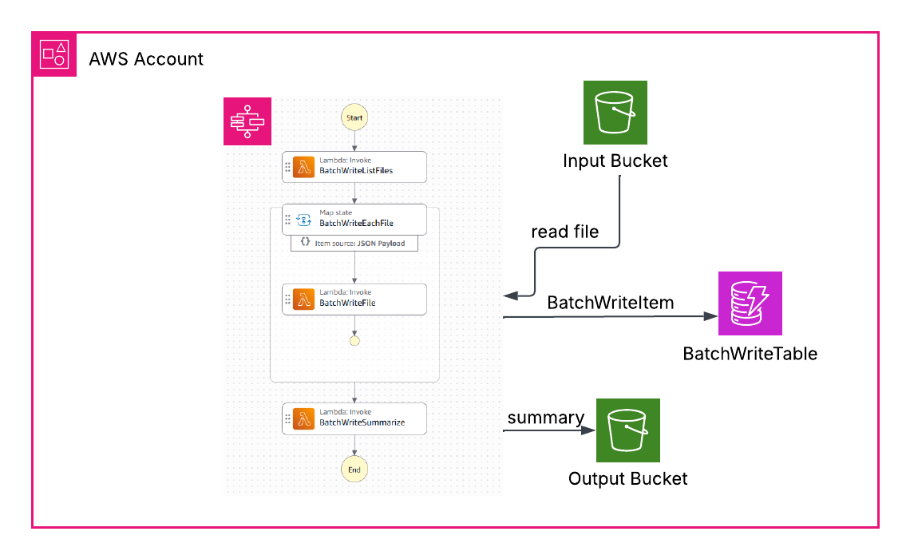
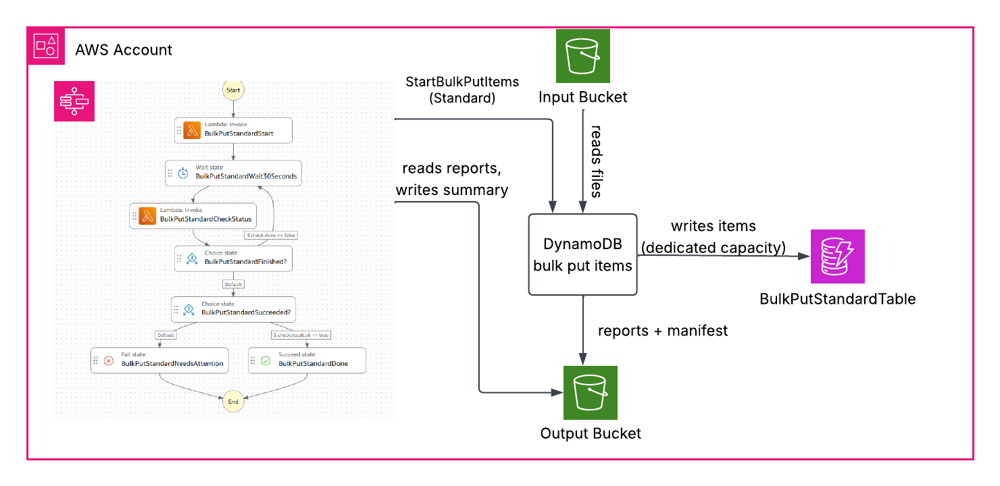
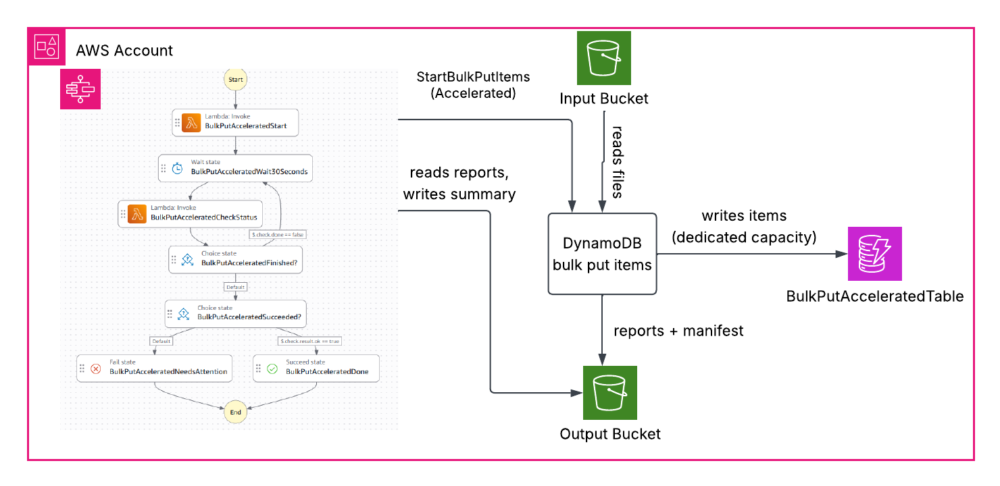

# Amazon DynamoDB Bulk Put Items

This project documents my learning from testing the new bulk put items feature in Amazon DynamoDB.

## Architecture

The app has these parts:

- **Input bucket:** the product files, as gzip JSON lines under `batches/<id>/data/`.
- **Output bucket:** the bulk put reports and manifests under `bulk-put-output/`, plus a summary file for each run under `bulk-put-output/summaries/`.
- **Three tables**, one per method: `BatchWriteTable`, `BulkPutStandardTable` and `BulkPutAcceleratedTable`. All are on-demand, with `sku` as the partition key.
- **Three Step Functions workflows**, one per method. You start them manually, with the same input.
- **Three Lambda functions**, all from `app/bulkput/handler.py`:
  - **`StartFunction`** (`start`) calls `StartBulkPutItems`. Its role is the bulk put items caller, so DynamoDB reads the input files and writes the reports with this role. Step Functions can't call `StartBulkPutItems` directly, so a Lambda makes the call.
  - **`CheckFunction`** (`check`) calls `DescribeBulkOperation` and publishes progress to CloudWatch. When the operation ends, it reads the reports and writes the summary.
  - **`BatchWriteFunction`** (`batch`) lists the files, writes one file with `BatchWriteItem`, or totals the results, depending on the `action` in its input.
- **`BulkPutComparison` dashboard:** items loaded, table write capacity used, and write throttles, for all three tables.

### BatchWrite workflow



- **BatchWriteListFiles** gets the list of files from the input bucket.
- **BatchWriteEachFile** runs `BatchWriteFile` for each file, 20 files at a time.
- **BatchWriteFile** reads one file and writes its items to `BatchWriteTable` with `BatchWriteItem`, 25 items per request on 16 threads. It retries unprocessed items and throttling with backoff. These writes use the table's capacity.
- **BatchWriteSummarize** totals the items, write request units and time, and saves a summary in the output bucket.

### BulkPutStandard workflow



- **BulkPutStandardStart** runs `StartFunction`, which calls `StartBulkPutItems` with the Standard tier. The execution name is the client token. If the table already has an operation running, the step waits and retries. DynamoDB then does the work:
  - reads the files from the input bucket
  - writes the items to `BulkPutStandardTable`, on dedicated capacity
  - writes the reports and manifest to the output bucket
- **BulkPutStandardWait30Seconds** waits 30 seconds.
- **BulkPutStandardCheckStatus** runs `CheckFunction`, which asks DynamoDB if the load is finished. When it is, the function reads the reports and saves a summary in the output bucket.
- **BulkPutStandardFinished?** goes back to the wait if the load is still running.
- **BulkPutStandardSucceeded?** ends in **BulkPutStandardDone** if the result is OK, or in **BulkPutStandardNeedsAttention** if not. OK means the status is `COMPLETED` or `COMPLETED_WITH_ERRORS`, the manifest was found, and every file was fully processed.

### BulkPutAccelerated workflow



This workflow has the same steps as BulkPutStandard. The only differences are the **Accelerated** tier and the table, `BulkPutAcceleratedTable`.

### Input

Each workflow takes the same input:

```json
{"bucket": "<InputBucketName>", "prefix": "batches/<id>/data/"}
```

In test setup 1, the input records are plain writes with no condition. `BatchWriteItem` can't use conditions, so leaving them out keeps the comparison fair. Test setup 2 adds conditions and runs only the two bulk put workflows.

## Prerequisites

- An AWS account and credentials in your shell (`aws sts get-caller-identity` works).
- Python 3.10+, Node.js, and a current CDK CLI: `npm i -g aws-cdk@latest`.
- Region: any commercial Region for `STANDARD`. `ACCELERATED` only in the Regions listed in the [docs](https://docs.aws.amazon.com/amazondynamodb/latest/developerguide/BulkPutItems.Tiers.html).

`cdk synth` runs `pip install --target` to bundle boto3 1.43.124 or later into the Lambda package. The Lambda runtime's own boto3 may not have `start_bulk_put_items` yet. boto3 is pure Python, so this works on any OS without Docker.

## 1. Deploy

```bash
git clone https://github.com/ssathasivan/amazon_dynamodb_bulk_put_items.git
cd amazon_dynamodb_bulk_put_items
python -m venv .venv
source .venv/bin/activate            # Windows: .venv\Scripts\Activate.ps1
pip install -r infra/requirements.txt -r app/requirements.txt

cd infra
cdk bootstrap                        # once per account and Region
cdk deploy
```

The deploy output has the input and output bucket names, the three state machine ARNs, and the dashboard URL.

## 2. Create the input files

Run the CLI from `app/`. It reads the bucket names and ARNs from the `BulkPutDemoStack` outputs. Add `--profile` and `--region` before the command if you don't use the defaults.

### Test setup 1: 1 million products

```bash
cd app
python -m bulkput generate --count 1000000 --batch catalog-1m --shards 20
```

This creates 1 million products, about 1 KB each, in 20 gzip files, and uploads them to `s3://<InputBucketName>/batches/catalog-1m/data/`. The records are plain writes with no condition.

### Test setup 2: conflict handling and the report

Run test setup 1 first. Test setup 2 uses the same tables, and both bulk put tables must hold `sku-000000000` to `sku-000999999` at `Version` 1.

```bash
python -m bulkput conflict-reset      # put the touched keys back to Version 1, delete the new keys
python -m bulkput conflict-generate   # create the records, upload them to batches/conflict-test/data/
```

- **`conflict-reset`** uses `BatchWriteItem` on the two bulk put tables. It writes the 80,000 existing keys back at `Version` 1 and deletes the 20,000 new keys, so the test can run again. These writes use the tables' capacity.
- **`conflict-generate`** runs `app/bulkput/conflict.py`. It writes 100,010 records, shuffled, in 4 gzip files:

| Group | Keys | Record | Condition | Expected result |
|---|---|---|---|---|
| `plain` | 0 to 19,999 | `Version` 2 | none | written, `Version` 2 |
| `insert_exists` | 20,000 to 39,999 | `Version` 2 | `attribute_not_exists(sku)` | skipped, stays `Version` 1 |
| `insert_new` | 1,000,000 to 1,019,999 | `Version` 1 | `attribute_not_exists(sku)` | written, `Version` 1 |
| `newer` | 40,000 to 59,999 | `Version` 2 | `#v < :v`, `:v` = 2 | written, `Version` 2 |
| `stale` | 60,000 to 79,999 | `Version` 1 | `#v < :v`, `:v` = 1 | skipped, stays `Version` 1 |
| broken | 10 records | no `sku` | none | in the `ERROR` report |

Expected totals: 100,010 records read, 60,000 written, 40,000 condition failures and 10 errors.

## 3. Start the workflows

### Test setup 1

```bash
python -m bulkput start --batch catalog-1m
```

This starts `BulkPutStandard`, `BulkPutAccelerated`, and `BatchWrite` at the same time, with the same input. With 1 million items, `BatchWrite` took 1 to 5 minutes, and the bulk put workflows took 9 to 23 minutes. To test a warmed-up table, run the same command again. It loads the same files into the same tables.

### Test setup 2

```bash
python -m bulkput start --batch conflict-test --bulk-only
```

This starts only `BulkPutStandard` and `BulkPutAccelerated`. `BatchWrite` isn't used, because `BatchWriteItem` can't apply conditions. Each load took about 3 minutes.

### Both tests

The execution name is `<batch>-<UTC time>`, for example `catalog-1m-20261109T101500Z`. Each bulk put workflow adds its own name to it to make the client token, so a retried start can't start a second operation.

You can also start a workflow yourself, from the Step Functions console or the AWS CLI:

```bash
aws stepfunctions start-execution \
  --state-machine-arn <BulkPutStandardArn> \
  --input '{"bucket": "<InputBucketName>", "prefix": "batches/catalog-1m/data/"}'
```

For test setup 2, use `"prefix": "batches/conflict-test/data/"`. Watch the runs in the Step Functions console and on the `BulkPutComparison` dashboard.

## 4. Check the results

Each run writes a summary JSON to `s3://<OutputBucketName>/bulk-put-output/summaries/`.

### Test setup 1

```bash
python -m bulkput compare
```

This prints one row per workflow for its latest run: status, items, total time, load time, items per second, cost, table write capacity used, and write throttles. CloudWatch metrics can lag by a few minutes, so run it again if the capacity column looks low.

An offline cost estimate, with no AWS access needed:

```bash
python -m bulkput cost --items 100000000 --item-bytes 1024
```

### Test setup 2

```bash
python -m bulkput conflict-check
```

Run this after both bulk put workflows finish. It reads the latest execution of each one and compares the report counts with the expected totals. It then reads all 100,000 touched keys with `BatchGetItem` and checks the `Version` of each key, group by group. It ends with `Result: matches the plan` or `Result: DOES NOT match the plan`.

### Test setup 3 with app traffic

This is the fourth 10 million-item load of test setup 3. It checks whether a load affects an application that uses the same table. Run it on new, empty tables, which is right after `cdk deploy`.

```bash
python -m bulkput generate --count 10000000 --batch catalog-10m --shards 100
python -m bulkput traffic-start --minutes 180 --reads 200 --writes 50
# wait at least 10 minutes for the baseline
python -m bulkput start --batch catalog-10m
# after all three loads finish
python -m bulkput traffic-report
python -m bulkput traffic-stop
```

- **`traffic-start`** starts the `AppTraffic` workflow once per table. It runs `AppTrafficFunction` in 10-minute chunks until `--minutes` have passed. Each chunk sends `--reads` `GetItem` requests per second to random `sku` keys and `--writes` `PutItem` requests per second to separate `app-` keys. It makes one attempt per request, with no SDK retries, and publishes `AppReadLatency`, `AppWriteLatency`, the request counts, the throttles and the other errors to the `BulkPutDemo` CloudWatch namespace every minute.
- **`traffic-report`** compares two windows for each table: the baseline, from the traffic start to the load start, and the time that table's load was running. It prints p50 and p99 latency, throttles, other errors and requests.
- **`traffic-stop`** stops the traffic early. Without it, the traffic stops by itself after `--minutes`.

The client's p99 latency most likely reflects client-side CPU contention in the Lambda that sends the traffic (48 threads at 250 requests per second on 1,024 MB), so compare windows with the p50, the throttles, and the `Srv` columns. `traffic-report` reads the `Srv` columns from `AWS/DynamoDB` for the app's `GetItem` and `PutItem` requests: `SuccessfulRequestLatency` p50 and p99, which exclude network and client time, plus `ThrottledRequests` and `SystemErrors`. Non-throttle errors are also published by type as `AppErrorsByType`, with `Operation` and `ErrorType` dimensions. The dashboard has two more widgets for this test: the app's write latency, and its throttles per table.

## 5. Clean up

```bash
cd infra
cdk destroy
```

Buckets use `auto_delete_objects` and tables use `RemovalPolicy.DESTROY`, so one command removes everything. Don't copy those settings into a production stack.

## Design notes

- **The caller is `StartFunction`'s role.** Bulk put items uses the caller's credentials to read S3 and write reports. `BulkCallerPolicy` gives that role the five bulk actions (`BulkPutItems` only on the two bulk put tables), read access to the input bucket, and write access to the output bucket.
- **Manual start.** All three workflows get the same input and start at the same time, so the only difference is the method.
- **`ClientToken` = `<workflow name>-<execution name>`.** A retried start returns the existing operation instead of starting a second one. The token can't be shared between tables. When both bulk put workflows used the same execution name as the token, DynamoDB rejected the second start with `IdempotentParameterMismatchException`.
- **One operation per table.** The start step retries `ResourceInUseException` with backoff, so a second run on the same table waits.
- **Bulk writes don't show in table metrics.** `CheckFunction` publishes `BulkPutDemo/ItemsProcessed` so the dashboard can show bulk put progress.
- **Reports are streamed and counted.** Report files sit in folders named `<operation-id>-0`, `<operation-id>-1`, and so on, so the code lists them without a trailing slash.

## Tested

us-east-1, November 2026. Test setup 1 ran with 1 million items, once on new tables and once on the same tables later. The first run was started by an S3 marker file through an EventBridge rule, which the code no longer has. The second run used `python -m bulkput start`. Test setup 2 used the commands above. Test setup 3 ran 10 million items in 100 files three times, with `generate --count 10000000 --batch catalog-10m --shards 100`, then a fourth time on new tables with app traffic. Results are in the article.

## Not covered

KMS-encrypted tables, cross-account buckets, global tables (unsupported), vector indexes, alerting (add an SNS topic or an alarm on failed executions).
